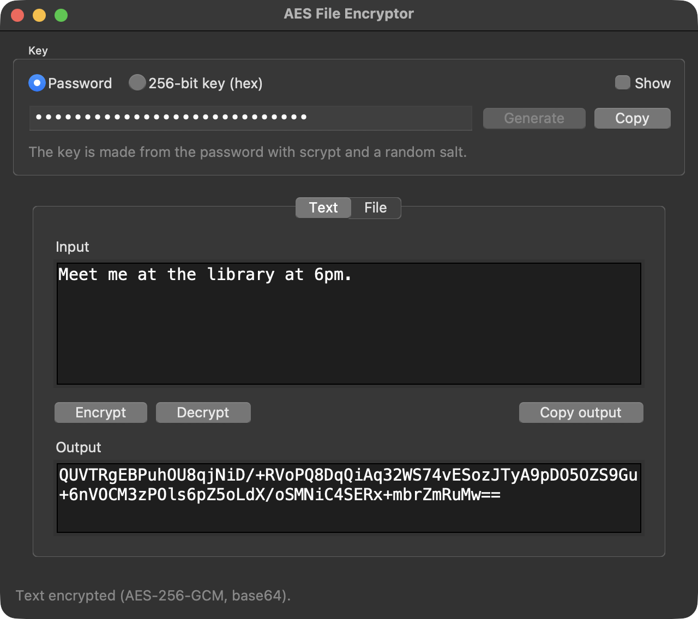
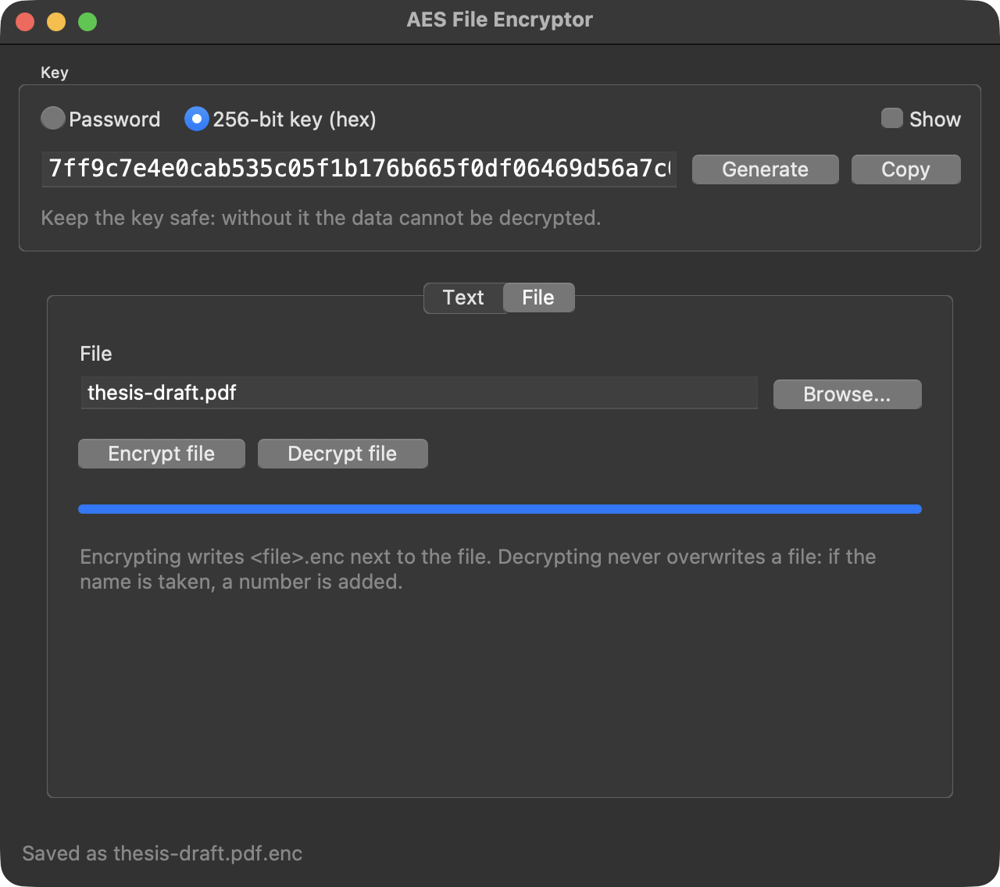

# AES File Encryptor and Decryptor

A desktop app in Python that encrypts and decrypts files and text with AES-256-GCM. You can use a password or a random 256-bit key, and any change to the encrypted data is detected when you decrypt it.



## Features

- **AES-256-GCM.** Encryption and integrity check in one: a wrong key, a changed byte or a cut-off file is rejected instead of giving garbage output.
- **Password or key.** A password is turned into a key with scrypt and a random salt, so the same password gives a different key for every file. Or generate a random 256-bit key and keep it yourself.
- **Large files.** Files are encrypted in 64 KB chunks, so they never have to fit in memory. Each chunk has its own nonce and tag, and the last chunk is marked, so removing chunks from the end is detected too.
- **Text.** Encrypted text comes out as base64, so you can paste it into a message or an email.
- **Safe output names.** Encrypting writes `<file>.enc`. Decrypting removes `.enc`, and if a file with that name is already there, a number is added instead of overwriting it.
- **Responsive GUI.** Files are processed in a background thread with a real progress bar.



## File format

| Part | Size | What it is |
|---|---|---|
| `AESF` | 4 bytes | Marks a file made by this tool |
| version | 1 byte | Format version (1) |
| mode | 1 byte | 0 = key, 1 = password |
| salt | 16 bytes | Salt for scrypt (random even in key mode) |
| nonce prefix | 8 bytes | Random; a 4-byte chunk counter is added to make each nonce |
| chunks | ... | Each 64 KB of data, encrypted, plus its 16-byte GCM tag |

The header and a "last chunk" flag are authenticated with every chunk, so they cannot be changed either.

## Installation

You need Python 3.8 or higher, with tkinter.

1. Clone the repository:
    ```bash
    git clone https://github.com/Arad-Afzali/AES-File-Encryptor-Decryptor.git
    cd AES-File-Encryptor-Decryptor
    ```

2. Create and activate a virtual environment (recommended).

    On macOS/Linux:
    ```bash
    python3 -m venv venv
    source venv/bin/activate
    ```

    On Windows:
    ```cmd
    python -m venv venv
    venv\Scripts\activate
    ```

3. Install the dependencies (only `cryptography`):
    ```bash
    pip install -r requirements.txt
    ```

## Usage

```bash
python3 main.py
```

1. In the **Key** box, choose **Password** and type one, or choose **256-bit key** and click **Generate**. A generated key is not saved anywhere: copy it and keep it safe.
2. **Text** tab: type or paste text, then click **Encrypt** or **Decrypt**. Use **Copy output** to copy the result.
3. **File** tab: choose a file, then click **Encrypt file** or **Decrypt file**.

To run the tests:

```bash
python3 test_aes.py
```

They check text and files of different sizes (empty, one chunk, several chunks), a flipped bit, a cut-off file and a wrong key.

## Project files

| File | What it does |
|---|---|
| `main.py` | Starts the app |
| `gui.py` | The tkinter window |
| `aes_crypto.py` | Key handling, scrypt, chunked AES-GCM for text and files |
| `test_aes.py` | Tests |

## Sending a key to someone

Anyone with the key or the password can decrypt the data, so don't send it next to the file. To send a key safely you can encrypt it with my [RSA Encryption and Decryption](https://github.com/Arad-Afzali/RSA-Encryption-Decryption) tool.
